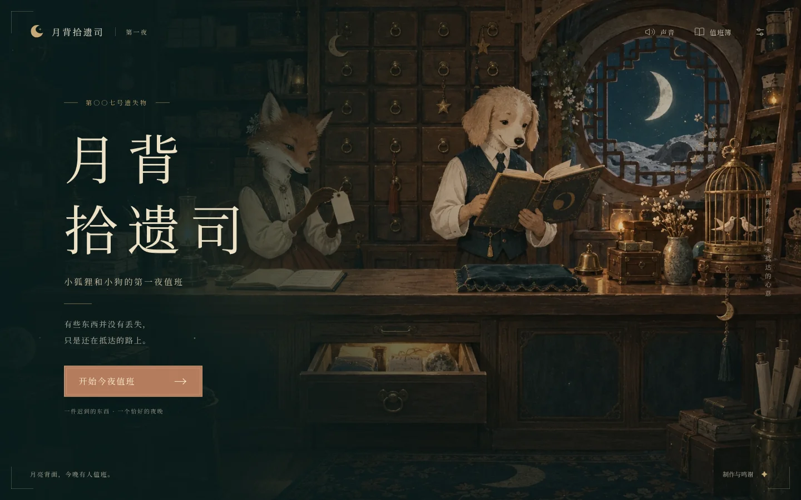

# oncewhere

**让值得记住的事，有一个可以再次走进的地方。**

我想留下的不只是一张照片或一句祝福，而是一种可以重新接近的感受。oncewhere 由袁诚志发起，探索故事、物件、动作和声音怎样共同承载表达；先理解想留下什么，再选择技术与载体。

## 代表作品：《月背拾遗司 · 第一夜》

一件关于迟到、照料与安放的互动小剧场。翻看一枚月牙胸针，拼起车票，等一句话抵达，修好最小的扣件，再把月亮收进第七号柜。

**现有 HTML 制作初版**包含五章故事、物件机关、音乐与音效、自动续玩、章节回看和单文件收藏版。作品按独立可理解的幻想故事制作，不声称还原了某段特定的私人经历；真实观众体验和音乐听感仍待进一步打磨。

### 如何体验

**本仓库已公开，源码、文档和截图可直接浏览，无需另行申请权限。** 要体验完整作品，无需安装开发环境：请先登录 GitHub，再进入 [Build oncewhere showcase](https://github.com/yuan-chengzhi/oncewhere/actions/workflows/showcase.yml) 的成功运行页面，在 **Artifacts** 中下载 **`oncewhere-showcase`** 展示包。

解压后用桌面浏览器打开 `index.html`，先看作品介绍与真实截图，再点击“进入第一夜”；也可以直接打开 `moon-office.html`。文件取得后，本地体验无需账号或服务器，支持离线打开。

**仓库页面不是在线试玩地址；当前提供下载后本地体验。** 展示包按工作流设置保留 30 天；找不到包时，请查看较新的成功运行，或按[构建方法](works/moon-office/README.md)自行构建。

[作品内容与构建方法](works/moon-office/README.md) · [展示包打开说明](showcase/README.md) · [素材与制作说明](showcase/CREDITS.md)

## 我希望在作品里保留什么

我在意的不是给故事附加更多功能，而是操作是否参与了表达：翻面让物件细节显现，拼接让两条线相遇，等待让一句话有了距离。项目通过 AI 辅助开展创作研究、方案选择、实现与迭代；不把全部代码、画面和声音包装成独立手工制作。

这个版本将插画、可编辑文字和确定的交互逻辑分开，使用 TypeScript、HTML/CSS/SVG 与 Web Audio。单文件收藏版让作品在离线时仍可打开；结尾导出的静态值班记录则是另一种更轻的纪念文件，不等于完整游戏。

## 项目仍然开放

《月背拾遗司》是首件作品，不是 oncewhere 唯一的媒介或永久的产品定义。Godot 原生样段与三维实验保留为后续探索；本次展示不要求把它们做成下一版，也不宣称已有商业验证。

原有项目概览完整保留在 [README.research.md](README.research.md)。[原始思考](docs/思考备忘录｜把共同经历变成可探索的作品.md)、[项目核心](docs/project-core.md)、[创作方式](docs/creative-approach.md)和[作品迭代记录](works/moon-office/review.md)记录问题如何变化，不必在第一次看作品之前全部阅读。

## 制作与分享

插画使用 AI 图像生成辅助制作；声音包含项目编排的钢琴音序和程序音效。钢琴音色使用 Alexander Holm 的 Salamander Grand Piano v3，保留 CC BY 3.0 署名与许可；作品字体沿用 Noto Serif SC 及其原许可。详细记录见 [CREDITS](showcase/CREDITS.md)。

展示包不携带 Git 历史、私人访谈、未整理故事、原始研究笔记或原生桌面程序。本次整理没有替整个仓库指定开源许可证；素材署名与许可说明仍需保留。自动化浏览器检查不等于真实手机、观众体验或听感验收。
