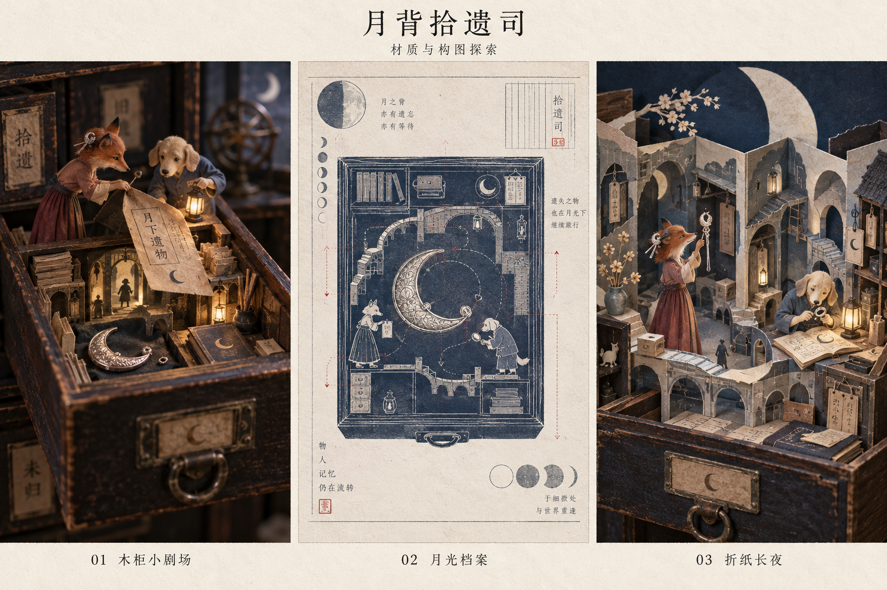

# 《月背拾遗司》：从故事到一件可以把玩的作品

研究日期：2026-09-21。状态：创作研究与形式比较，尚未进入作品实现。

后续进展：用户认可柜中小剧场并授权自主制作后，已形成[第一轮可玩版本](../works/moon-office/README.md)。本文保留为实现前的研究快照，下文的“尚未实现”描述当时状态；当前范围与验证记录见作品目录。

故事来源：[《月背拾遗司》初稿](月背拾遗司.rtf)。项目背景：[创作方式讨论](creative-approach.md)、[此前的产品地图](product-map.md)。本文保留原稿，将改编提议另列。

**当前最值得探索的方向：一座可以把玩的柜中小剧场。** 玩家与两位值班员一起翻票据、听回声、修扣件、留下灯，逐渐为那件迟到的饰品找到位置。旧木柜、登记簿和首饰既是画面里的东西，也是组织体验的方式。

本轮暂按“陌生人也能理解的幻想故事”开展研究。小狐狸与小狗是否对应真实的人、饰品是否有真实原型、作品送给谁，均未确认；不据此补写私人经历。独立幻想创作本身可以继续推进。

证据范围：查阅作者、发行商、博物馆的公开资料及开源仓库；查看了 Papetura 的官方场景图，生成并检查了一张本作美术探索图。没有完整实玩这些商业游戏，没有做用户测试，没有验证代码候选在目标设备上的运行效果。下文明确区分**来源事实、设计分析、改编提案与待验证判断**。“独一无二”是创作追求，本轮参照研究不能证明不存在类似作品。

## 1. 初稿已经给了我们什么

| 原稿中的具体细节 | 我的理解 | 可能转成的体验 |
|---|---|---|
| 旧衙门、登记簿、没有关严的抽屉 | 神奇事物有日常的保管方式，带一点认真办事的幽默 | 打开、翻检、登记、盖章；界面可以长在物件上 |
| 不能改变过去，只能把准备好抵达的东西送回去 | 角色的能力有边界；他们可以照料当下 | 操作改变现在的摆放、接收与理解；过去的记录保持原样 |
| 狐狸发现未知，小狗记住回路 | 关系同时需要好奇与可靠，两人各有能动性 | 同一物件从两个角度看；一人发现，一人让发现成为可走的路 |
| 声音会迟到；越急着说话，回声越混乱 | 时间差本身能被感到 | 看见话语在路上，安排接收的间隔；等待期间仍可观察和把玩 |
| 小狐狸试戴，小狗认真登记，星星别到衣领上 | 这是关系里可爱的日常，能缓和寓言的庄重 | 允许试戴与逗趣；小狗也有自己的喜好和反应 |
| 真正缺少的是不起眼的扣件 | 细小结构决定一件东西能否被使用、被留下 | 让玩家观察连接处、托住弹片、亲手合拢 |
| “下次一起打开”；时光鸟逃出来 | 结尾留下一处可重返的地方，还有一点生活继续的混乱 | 完成后的抽屉保留摆放；鸟在原场景里闲逛，成为可重看的小动作 |

我想优先保留的感受是：**你可以走向未知，我们也能一起给某件东西留个位置。** 这是一种工作读法，尚不替作者给故事定主题。

初稿也有几个值得继续写实的地方：

- **第一段时间的推理依据。** “按它们想去哪里分类”很有诗意，但车票上的“等待、回头、放下”等词目前没有可验证的分类关系。直接变成游戏，容易让玩家猜作者偏爱的解释。需要补充看得见的图形、磨损、孔位或场景关系。
- **三个片段之间的递进。** 现在都有“抵达奇景—理解一句话—获得一部分”的节奏。可以让它们分别教会玩家观察位置、理解间隔、完成协作；最后一次操作调用前面认识到的东西。
- **时间字段的规则。** 开头“找到时间：今晚”，结尾变为“找到时间：很多年以后”。这可以是有意的时间悖论，但目前缺少辨认它的依据。建议先明确各字段记录谁的时间；一个较简单的改写候选是保留“找到时间：今晚”，让“可领取时间”从未知变为现在。
- **等待与期限的关系。** “月亮关闭之前”会让人以为有倒计时；回声段又邀请人慢下来。可以将它写成夜班的叙事边界，允许玩家从容完成；若要真实限时，应另行讨论它带来的情绪。
- **两位角色的主动性。** 小狗已经提出“不要按年份排”，这是很好的能力展示。可以让他还主动追查某种钟声、研究扣件，让小狐狸有机会好奇地跟随、帮忙或等待。他们的差异不必消失，但两个人都值得被照料。
- **饰品的具体性。** 初稿允许它像胸针又像可拼合手链。后续应选定一个能画出正面、背面和闭合方式的结构。若有真实原型，优先从原型取材；没有时就明确作为虚构物件设计。它的缺口应从开场就看得见。

## 2. 十个参照，各取一个有用的问题

下表第一列是公开资料可支持的机制；其余两列是本轮分析。链接均为本轮查阅来源，推荐用于理解创作方法，不代表已购买或完成实玩。

| 作品与来源事实 | 对《月背拾遗司》的启发 | 采用时需要取舍 |
|---|---|---|
| **[Gorogoa](https://www.annapurna.com/interactive/gorogoa)**：玩家排列、组合手绘画格来解谜 | 两件原本分离的东西放到一起，产生一个新的空间关系。车票背面与柜中场景可以相互解释 | 借鉴“发现关系”的喜悦；每个画面都需要为机关精确设计，插画数量不是主要难点 |
| **[Moncage／笼中窥梦](https://optillusiongames.artstation.com/projects/2qADry)**：立方体各面有不同场景，玩家调整视角，寻找跨面的视觉连接 | 柜中小景可以容纳远方；视角本身能成为操作 | 透视对齐会增加相机、触控和美术精度的负担，先用固定视角比较效果 |
| **[Florence](https://www.annapurna.com/interactive/florence)**：用一系列为关系片段专门设计的交互，讲述两个人的变化 | 某段对白可以通过动作的速度、距离和停顿被理解 | 学习动作与关系的对应；本作应保留自己的幻想、幽默与开放结尾 |
| **[Assemble with Care](https://ustwogames.co.uk/our-games/assemble-with-care/)**：修复人物珍爱的物品，并接近他们的关系 | 修扣件时，物理细节可以让“替它留个位置”获得分量 | 一次修理可以表达照料；不必把每个关系问题都写成修好物件就能解决 |
| **[The Past Within](https://blog.rustylake.com/qa-with-rusty-lake-about-the-past-within-devlog-7/)**：作者从单人盒内／盒外构想转向双人合作，两人看到不同环境，需要交流 | “两人同时到场”可以成为真实的共同经历；各自掌握的信息要有互补价值 | 双人版会改变谜题、节奏和测试方式，值得作为独立方向。不能只给单人版加一个第二角色按钮 |
| **[Papetura](https://www.feardemic-games.com/papetura)**：纸制角色与环境、光影、音乐和声音共同构成解谜冒险，故事没有对白 | 明确的材料可以统一本来很不同的场景。纸的透光、折痕、厚度都能参与表现 | 其手工材料是实际制作方法。本作的生成图只能证明视觉方向值得讨论，不能当作已制成纸偶或模型 |
| **[Windosill](https://vectorpark.itch.io/windosill)**：通过点击和拖动，引导玩具车穿过十个微型世界 | 有趣也可以来自“碰它一下，它居然这样回应”。首饰摊和时光鸟适合这种小惊喜 | 留几件纯粹好玩的东西，同时保持主线物件清晰。作者页提到的旧网页演示依赖 Flash，不能当作现代浏览器可直接试玩的保证 |
| **[While Waiting](https://store.steampowered.com/app/2449160/)**：等待本身可以推进场景，官方描述允许什么也不做地过关 | 回声还在路上时，玩家可以拨动石子、看小狗整理衣领、观察风声；空隙也能有内容 | 等待长度、反馈和跳过方式都要试。长时间没有变化，可能只会让人以为卡住 |
| **[Wayfinder](https://www.canada.ca/en/national-film-board/news/2021/06/what-ageless-tale-is-the-landscape-whispering-today-it-may-never-be-whispered-again-wayfinder-an-animated-interactive-journey-across-the-poetry-of-.html)**：网页中的自然漫游与诗句发现结合，采用生成方法 | 完成之后的拾遗司可以是一处能短暂停留的地方，允许无任务地听和看 | 随机变化可以留给星尘、鸟的走动等细节。核心对白与私人含义需要作者确定，作品也应有可保留的版本 |
| **[Joseph Cornell：Object (Roses des vents)](https://www.moma.org/collection/works/81694)**：木盒内有装指南针的托盘、小物件，以及衬着地图的盒盖 | 空间很小，物件之间的关系仍能让人想到遥远的地方。抽屉有机会成为本作真正的舞台 | 借鉴陈列、尺度和留白的思考方式，设计自己的构图、物件与图像 |

两个补充比较也有用：[Carto](https://blog.playstation.com/2020/10/27/inside-the-story-of-carto-out-today-on-ps4/)把重排地图作为贯穿冒险的中心机制；[Storyteller](https://annapurnainteractive.com/games/storyteller)让人物和场景的排列产生故事。前者提醒我们关注玩法的一致性；后者适合检验“人物关系能否从画面中读出”。但《月背拾遗司》已有“不改变过去”的规定，若让玩家自由重写往事，会需要重定世界规则。

**本轮收获：** 一件作品的辨识度，常常来自材料、动作、声音和叙事反复支持同一件事。我们的机会在于把拾遗司的具体工作做得可信、有趣：收什么，怎么认，怎么放，谁会等谁，什么东西可以继续留在那里。

## 3. 三种真正不同的作品形式

以下均为候选，不同时立项；时长仅是比较尺度的创作目标，尚无实测。

| 方向 | 观众实际做什么 | 最适合表达什么 | 最难的地方 | 留下什么 |
|---|---|---|---|---|
| **A. 柜中小剧场**，约 20–30 分钟，单人可完整体验 | 把抽屉拉开，翻检票据，拨动灯与零件；两位角色在柜中行动，玩家安排他们共同工作的条件 | 奇景、物件触感、轻解谜与角色日常 | 玩家是否看得出可操作处；每个动作是否带来清楚反馈 | 一只按本夜结果摆好的抽屉、夜班记录、可直达的章节 |
| **B. 两份夜班簿**，双人约 20–40 分钟 | 两人分别持有狐狸和小狗看到的记录，互相描述；一个看得见旧标签，一个听得清钟的顺序 | 合作、不同的注意、话语抵达的过程 | 两个人都必须有发现与行动；一人读答案、另一人照办会很无趣 | 两份能合在一起读的值班记录；纸面样本也可先验证 |
| **C. 第七号抽屉：一件纸上机关作品**，约 10–20 分钟 | 打开小盒或折页，翻透明票据、拉纸条，让回廊展开；最后两枚纸扣合拢 | 礼物的仪式、手上真实的阻力、保存的自然性 | 纸张厚度、机关强度、装订与寄送；声音段需要重新写成纸面节奏或附加音轨 | 完整纸物；数字图文版作为补充 |

**优先比较 A 与 C。** A 最能容纳初稿的三个奇景和轻喜剧，C 能检验这些物件是否有足够魅力让人愿意持有。若“这次就是要两个人一起经历”得到确认，B 的优先级会上升。

A 的角色定位也需要明确：玩家暂作为安排舞台、协助两位值班员的无名之手，不额外写入第三位主角。单人游玩不要求模拟两个人同时按住屏幕；可以先让一个角色稳稳托住，再让另一位完成装配。故事中的协作通过角色动作成立。

## 4. 推荐方向的体验草案

本节全部是**新增改编提案**，不是对原稿既有玩法的描述。

### 4.1 开场六格：先让一件物品吸引人

前约 90 秒是节奏草案，实际允许停留。

| 分镜 | 看见与听见 | 玩家动作与反馈 | 为什么放在这里 |
|---|---|---|---|
| 1 | 一小块被灯照亮的柜台。小狗在核对登记簿；画外有细微拨弄耳坠的声音 | 触碰台灯或选择点灯，声音与画面一起开始；静音也有清楚反馈 | 从具体工作进入世界，先不要求读世界观说明 |
| 2 | 第七号柜自己弹开一点，标签晃动 | 拉开或点击打开；里面的月牙饰品滑到软布上 | 把一个日常动作变成第一处小惊奇 |
| 3 | 饰品很漂亮，背面有一个实际看得见的空扣座 | 翻面，银面随角度反光，小狐狸注意到一处纹路 | 美和问题同时出现，后续修理有视觉依据 |
| 4 | “遗失时间：很多年以后／找到时间：今晚”的标签 | 翻起标签，发现旧胶痕或另一层标记；登记簿保留所见原文 | 玩家开始观察异常；不让他凭空改写记录 |
| 5 | 小狐狸掀起柜内的隔纸，小狗挪灯照亮后面 | 移灯后，纸后的候车室轮廓显出来；两个角色各做一件事 | 用一次很小的合作建立这件作品的动作语言 |
| 6 | 柜内隔层展开成候车室，抽屉木边仍在画面边缘 | 点击或靠近亮起的入口，进入第一段时间 | 空间发生变化，保留“这是一个能收起来的地方”的尺度感 |

开场应让人至少想继续确认一件事：这个时间标签是什么意思，或这个柜子还会怎样展开。无需在这时理解全部寓意。

### 4.2 三段时间：三个不同的发现

**候车室：观察同一件东西的另一面。**

保留错乱的年份和有趣的票面文案，另加三张票背面的长椅局部图。每张只包含一条可对照的痕迹：椅脚缺口、灯的投影、扶手的磨损。玩家把票放到登记簿的观察窗中移动、转正，能与候车室里对应的位置对上。

三处位置拼出同一段长椅，饰品曾停留的轮廓就在靠近一只手的位置。日期没有被改动，玩家找到了记录之间的空间关系。原稿中的“等待、回头、一起走”可以在认出场景后成为描述，不承担含糊的标准答案。

错误摆放应有局部反馈：某条椅背纹路接上了，另一个孔却对不上。允许随时拿起重排，也允许请求提示。先用三张纸与一幅长椅图验证；若必须解释“作者想表达什么”才能解，改掉机关。

**回声星球：看见一句话还在路上。**

小狐狸与小狗的一句短话各沿不同长度的弧线前进，以细小光点及字幕标明说话者和出发位置。一次试着连续发声，会让路径变得拥挤；已发出的声音继续前行，不因“操作错了”被清空。

玩家可以让两人坐到同一条长椅上，整理待说的话，等前一句抵达，再放出下一句。把等待设计成一次看得见的过程：光点逐步接近，人物有小动作，原稿的“我在这里／我知道”最后才完整相遇。

可比较两版：一版只是观察并等候，另一版让玩家整理两条话语路径的间隔。起始可试数秒量级，时长由体验决定；保留重听、字幕、加快／跳过等待。不把听力、按键节拍或长时间不动作为过关条件。

**首饰街：漂亮与有用都值得看。**

先留一小段自由试戴：小狐狸挑选，小狗被别上星星后自己扶正它，登记簿出现原稿中的认真吐槽。这里的趣味来自两个人的反应。

随后，狐狸发现藏在花纹里的扣座，小狗比对从开场就可翻看的饰品背面；旧扣子的尺寸与磨损解释它为什么合适。按“托住弹片—放入扣件—合拢”的顺序完成修理。容差应宽，能撤回；抓不到一个细小像素不应成为主要困难。

月面回路保留。可以由玩家沿探索路线放几盏灯，回头时清楚看见这些灯还亮着。狐狸继续前行的自由和回路的可靠性都在画面里存在；也为小狗安排一个他主动发现、狐狸愿意驻足的细节。

### 4.3 结尾由玩家完成“安放”

回到第七号柜，玩家将票据、透明石头和饰品放好。位置可以有少量自由，保证文字和饰品仍清楚可见。小狐狸与小狗贴上原稿中的标签：**“下次一起打开。”**

最后的有效操作可以是轻轻合上抽屉。停一拍，时光鸟从没有关好的笼里出来，紧接原稿的笑话。镜头回到有两位值班员和鸟的空间，让观众选择停留或结束。

之后再次打开，目标是直接看见自己安放过的东西，可以翻到夜班记录或重看某段。首次体验的动作有结果，复访不必重解谜。保存这些状态和导出记录是后续实现要求，目前尚未具备。

## 5. 美术、声音与文字怎样一起成立

本轮用内置 imagegen 生成了以下探索图。三栏比较材料处理，不是三种已实现界面，也不对应上面的三种玩法方向。

图像：[原始 PNG](assets/moon-office/material-studies.png)。过程与完整提示词见[素材说明](assets/moon-office/README.md)。

| 画面路线 | 值得保留 | 仍需修正与验证 |
|---|---|---|
| 01 木柜小剧场 | 木材磨损、窄光源、盒中尺度，物件有可拿起的感觉 | 生成图的角色偏写实，需要比较更简洁的纸偶剪影；暗处也要能辨认操作物 |
| 02 月光档案 | 靛蓝、银线、纸张与图解，适合票据和登记簿 | 密集线条缩到手机会丢失；图中的附加文字是模型生成的装饰，不能当作正式文案 |
| 03 折纸长夜 | 折页的空间层次、纸边、首饰街的展开方式 | 场景目前过满，应减物件；保留一两个亮点，给角色动作留空间 |

我的初步偏好是 **01 的空间尺度，配合 02 的档案平面设计**。03 可作为纸物路线的独立候选。后续要对同一场景做动作分镜，验证两种材料能否自然共存，不能仅靠拼贴三种漂亮风格定稿。

建议建立几条具体的美术规则：

- **材料有限。** 旧木、素纸、氧化银、玻璃承担主要质感。每种材料有自己的反馈：木头有阻力，纸会翘边，银要转动才显纹，玻璃让月光穿过去。
- **亮度有次序。** 大部分空间保持安静，眼前要读的标签与要拿的扣件先清楚；出现新线索时再改变局部光照。
- **角色靠习惯辨认。** 狐狸掀标签的手势、尾巴让开抽屉的动作，小狗写字前扶正本子的停顿，都比增加饰品数量更能建立人物。两人都需要主动、得意、被逗笑的时候。
- **中文属于场景。** 正文清楚可读，登记字段克制，手写感只用于少量批注；正式文字后期排版，不烘在生成背景里。
- **场景变化遵守一套逻辑。** 票据翻面、抽屉拉开、隔纸展开，都以原物件的动作引出新空间；转场延续玩家刚做的事。

声音可以从少量近处的声音开始：木轨摩擦、纸页、扣件的金属声、两只鸟不同的报时声。需要时再进入音乐。回声段的说话者、方向与延迟同时有视觉表示；正常打开作品先由用户动作启动声音，静音时仍能理解主线。这是体验要求，尚待设备实测。

AI 图像最有用的阶段是比较材质、构图与光线。进入制作后应先确定角色正侧面、饰品结构和色彩规则，再生成或绘制分层资产，并由人工修正连续场景的一致性。机关孔位、扣件匹配、正式文案和关键线索必须可控。一张成图并不等于能动、能拆、能解谜的一套素材。

## 6. 开源项目：哪些部分值得复用

本轮读取了相关 README、许可文本与指定样例／文档。未安装、运行、fork 或引入项目依赖。下列是研究快照，不能写成兼容性与性能验收。

| 候选 | 已核实的内容 | 适用判断 |
|---|---|---|
| **[ink／inkjs](https://github.com/y-lohse/inkjs)** | ink 是叙事语言；inkjs 是 JavaScript 实现。活跃候选仓库有 `templates/browser_serverless/`，示例用 `Story`、`Continue()`、`currentChoices` 推进文字与选择；许可为 MIT。[ink 说明](https://github.com/inkle/ink)、[inkjs 许可](https://github.com/y-lohse/inkjs/blob/6b1153410ab1c4bcfd9ef04eb2f0107f36be7778/LICENSE.md) | 适合对白、章节与条件状态。若只有线性短篇，简单状态表也足够。它不提供物件操作、美术、声音设计或谜题体验 |
| **[PixiJS](https://github.com/pixijs/pixijs)** | 官方 README 列出 2D 渲染、精灵、遮罩、资源加载及鼠标／触摸支持；MIT。[许可](https://github.com/pixijs/pixijs/blob/ecd3797cf9b57766b045f3eea8388db9677744f8/LICENSE) | 若 A 需要较多纸层、局部光与拖动物件，可以作为绘制层。正文与可访问操作可用 HTML 层承接。普通安装依赖即可，暂未发现必须 fork 的理由 |
| **[Decker](https://github.com/JohnEarnest/Decker)** | 多媒体交互文档工具；Web 版本可形成独立 HTML，MIT。文档描述的字符串／导入转换使用 DeckRoman，范围外字符不能直接保留。[文档](https://github.com/JohnEarnest/Decker/blob/340152d68e06f480094fe2df328b760da7fe44be/docs/decker.md)、[许可](https://github.com/JohnEarnest/Decker/blob/340152d68e06f480094fe2df328b760da7fe44be/LICENSE.txt) | 卡片、超文本与档案的呈现值得学习。中文正文会面临实质适配工作，把文字全部变成图片又会损失编辑与可访问性，因此暂不作为本作首选。其贡献说明明确不接受生成式 AI 辅助的上游 PR，本轮没有向上游提交内容 |
| **[Bitsy](https://codeberg.org/adamledoux/bitsy)** | [旧 GitHub README](https://github.com/le-doux/bitsy/blob/ee412fa8c072d16af4aedd90d4ad3fb7306911b0/README.md)明确仓库已归档并迁至 Codeberg；当前 Codeberg README 介绍小型游戏／世界创作，并注明作者正聚焦 Bitsy 9、暂不接受 PR／issue。旧仓库标注 MIT；新仓库完整许可与版本兼容本轮未再核验 | 若想先看“两个角色在一个小房间里是否可爱”，是候选工具。精细首饰操作与纸木质感需要另做，因此现阶段主要借鉴小世界的取舍 |

可复查的读取位置：

- inkjs 快照 `6b1153410ab1c4bcfd9ef04eb2f0107f36be7778`：[浏览器样例 main.js](https://github.com/y-lohse/inkjs/blob/6b1153410ab1c4bcfd9ef04eb2f0107f36be7778/templates/browser_serverless/main.js)。另查的 `inkle/inkjs` 镜像，其默认分支最近提交停在 2022 年；本轮将 `y-lohse/inkjs` 作为后续候选入口，不从镜像时间推断整个项目停止维护。
- Decker 快照 `340152d68e06f480094fe2df328b760da7fe44be`：[README](https://github.com/JohnEarnest/Decker/blob/340152d68e06f480094fe2df328b760da7fe44be/Readme.md)、上述 `docs/decker.md`。
- PixiJS 默认开发分支快照 `ecd3797cf9b57766b045f3eea8388db9677744f8`：[README](https://github.com/pixijs/pixijs/blob/ecd3797cf9b57766b045f3eea8388db9677744f8/README.md)。此处记录读取位置，不建议以后直接锁定开发分支作为生产依赖。

若之后选择 A，可先比较“固定镜头的 2D 分层画面＋少量状态”是否够用，再决定是否引入 PixiJS 与 inkjs。若选择 B，先用两份纸面信息验证交流是否有趣，再讨论同屏、两台设备或联网。C 应先验证纸机关。商业游戏在这里作为创作参照，本轮未获得它们的代码或素材复用许可。

## 7. 下一步最值得做的三个小实验

以下实验还没有开展。它们各自回答一个问题，结果允许改变当前偏好。

| 实验 | 可以直接用的材料与步骤 | 观察什么 | 哪种结果意味着该改方向 |
|---|---|---|---|
| **三张车票** | 画一幅有三处特征的长椅，剪三张背面局部图；给人看票面与背面，观察能否对上位置 | 玩家是否通过证据发现关系；试错是否有局部进展 | 必须解释词语寓意才能拼出，说明谜题线索不成立；若纯阅读一样好，可删机关 |
| **一句迟到的话** | 两人分别读一句原稿对白，比较直接接话、短暂停顿、带可见路径的分镜三个版本 | 等候是否改变对话的感受；观众会不会以为已经结束或卡住 | 只有不耐烦、没有新的注意，就缩短或改成观看；不强行保留延迟机制 |
| **合上第七号柜** | 用一个真实小盒、简单纸饰品、标签和几张票据排演结尾，再与六格图文结尾比较 | 观众是否自然想安放、翻看；鸟的笑话是否让人物更鲜活 | 只在意“机关很酷”，认不出角色关系，就回到人物和选材继续写 |

三个实验里，优先做“合上第七号柜”。这个结尾能否让人愿意留下作品，比先扩充全部场景更能帮助我们判断形式。

进入制作前仍需明确三件事：主要给谁看、通常在哪种设备或实体情境打开、饰品与角色有多少私人原型。这些信息会改变细节和交付方式，不阻止当前的幻想创作研究。

本轮实际交付为本文、三栏美术探索图及其提示词，并更新仓库阅读入口。故事原稿保持原样，项目仍处于研究阶段；现有技术库 Markdown 与 HTML 阅读快照均未修改。
